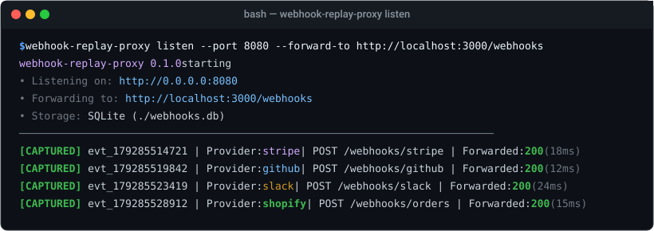
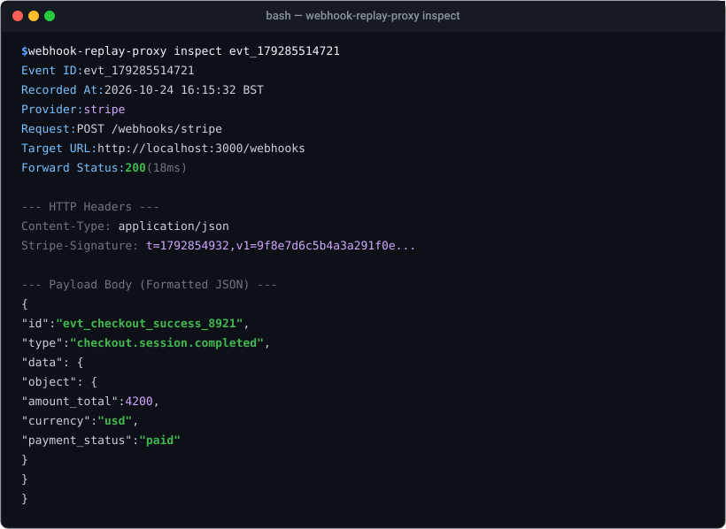

# Getting Started

This guide walks you through installing `webhook-replay-proxy`, starting the capture listener, and replaying your first mutated webhook.

---

## 1. Start the Capture Listener

Point your webhook tunneling tool (e.g. ngrok, Cloudflare Tunnel, or Stripe CLI) to `webhook-replay-proxy` on port `8080`, and instruct `webhook-replay-proxy` to forward requests to your development application:

```bash
webhook-replay-proxy listen \
  --port 8080 \
  --forward-to http://localhost:3000/api/webhooks \
  --db ./webhooks.db
```

Output:
```text
webhook-replay-proxy 0.1.0 starting
• Listening on: http://0.0.0.0:8080
• Forwarding to: http://localhost:3000/api/webhooks
• Storage: SQLite (./webhooks.db)
```



---

## 2. Ingest an Incoming Webhook

When a webhook arrives from Stripe or GitHub, the proxy records the request details into `./webhooks.db`, forwards it to `http://localhost:3000/api/webhooks`, and outputs a log entry:

```text
[CAPTURED] evt_179285514721 | Provider: stripe | POST /webhooks/stripe | Forwarded: 200 (18ms)
```

---

## 3. List Captured Events

To see all events captured in your SQLite flight recorder:

```bash
webhook-replay-proxy list
```

Example Output:
```text
ID                   TIMESTAMP            PROVIDER  METHOD  PATH              STATUS  LATENCY
evt_179285514721     2026-10-24 16:15:32  stripe    POST    /webhooks/stripe  200     18ms
evt_179285519842     2026-10-24 16:15:45  github    POST    /webhooks/github  200     12ms
evt_179285523419     2026-10-24 16:16:01  slack     POST    /webhooks/slack   200     24ms
```

---

## 4. Inspect Full Event Details

Inspect headers, pretty-printed JSON payload, target response body, and previous replay executions:

```bash
webhook-replay-proxy inspect evt_179285514721
```



---

## 5. Replay with Mutations & Fresh Signatures

To replay this event against your local app with fresh HMAC signatures and altered data:

```bash
webhook-replay-proxy replay evt_179285514721 \
  --secret whsec_your_dev_secret \
  --set data.object.amount=999999 \
  --diff
```

The tool will:
1. Mutate `data.object.amount` to `999999`.
2. Generate a current Unix timestamp.
3. Compute a valid `Stripe-Signature` header matching the new payload and timestamp.
4. Display the visual diff.
5. POST the request to `http://localhost:3000/api/webhooks`.

Next, review the [Worked Examples](worked-examples.md) for Stripe, GitHub, and idempotency race-condition tests!
