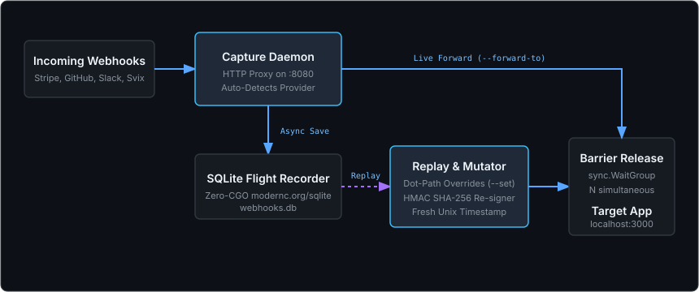

# webhook-replay-proxy

> **Deterministic local webhook recorder, SQLite flight recorder, payload mutator, and cryptographic HMAC re-signer for edge and cloud microservices.**

[](https://github.com/smford/webhook-replay-proxy/actions/workflows/ci.yml)
[](https://github.com/smford/webhook-replay-proxy/releases)
[](https://opensource.org/licenses/MIT)

---

## What is webhook-replay-proxy?

`webhook-replay-proxy` is a single-binary, zero-CGO developer tool written in pure Go. It acts as a local proxy between incoming third-party webhooks (from services like **Stripe**, **GitHub**, **Slack**, **Shopify**, and **Svix / Standard Webhooks**) and your local development server or test environment.

It records incoming webhook requests into an embedded SQLite flight recorder database (`webhooks.db`), and lets you replay them on demand—even hours or days later—with **mutated payloads**, **fresh timestamps**, and **recalculated cryptographic HMAC signatures** so your application middleware never rejects them.

---

## The Problems It Solves

Testing webhooks locally has historically been frustrating for two major reasons:

### Problem 1: Timestamp Expiration Breaks Replay
Modern webhook providers (such as Stripe, Slack, and Svix) include a signed Unix timestamp in their HTTP headers (`Stripe-Signature: t=1690000000,v1=...`, `X-Slack-Request-Timestamp: 1690000000`). Application SDKs and middlewares enforce a strict tolerance window (typically **5 minutes**).
- **The Pain:** If you capture a production or sandbox webhook and try to replay it 10 minutes later using curl or Postman, your application middleware immediately rejects it with:
  ```text
  Stripe::SignatureVerificationError: Timestamp outside the tolerance zone
  ```
- **How We Solve It:** `webhook-replay-proxy replay` automatically generates a **current Unix timestamp** at the exact millisecond of replay, bundles it into the signed payload string according to each provider's specification, and computes a fresh valid HMAC signature using your local webhook secret.

### Problem 2: Payload Mutation Breaks Signatures
When testing edge cases—such as an invoice payment failing, a chargeback occurring, or an order amount exceeding limits—developers often manually edit the captured webhook JSON payload (e.g. changing `"amount": 2000` to `"amount": 999999` or `"type": "invoice.payment_failed"`).
- **The Pain:** Modifying even a single character in the JSON body invalidates the original cryptographic HMAC hash. The receiver middleware halts with:
  ```text
  Signature verification failed: computed HMAC does not match request header
  ```
- **How We Solve It:** With `--set <key.path=value>`, `webhook-replay-proxy` mutates the JSON body in-memory, prints a visual diff, and **recalculates the exact HMAC-SHA256 signature** over the new payload.

### Problem 3: Concurrency & Idempotency Testing
When network retries happen in production, webhooks arrive simultaneously. Does your database lock properly? Does your inventory decrease twice?
- **The Pain:** It is virtually impossible to trigger simultaneous webhooks manually via browser or curl.
- **How We Solve It:** With `--concurrency <N>`, `webhook-replay-proxy` sets up a synchronized goroutine barrier (`sync.WaitGroup`) and fires $N$ identical requests at the exact same instant to stress-test your idempotency locks and database transactions.

---

## Architecture Overview



1. **Capture Daemon (`listen`)**: Binds to a local port (e.g., `:8080`), accepts incoming webhooks, and forwards them in real-time to your backend (`--forward-to http://localhost:3000/webhooks`).
2. **Pure-Go SQLite Flight Recorder**: Stored in a single zero-CGO file (`webhooks.db`). Captures HTTP method, path, query, raw headers, body, forward status, response body, and round-trip latency.
3. **Dot-Path Payload Mutator**: Modifies strings, numbers, booleans, and nested JSON objects before re-signing.
4. **Cryptographic Signer**: Generates and verifies spec-compliant HMAC-SHA256 signatures for Stripe, GitHub, Slack, Shopify, and Standard Webhooks.
5. **Synchronized Barrier Replay**: Releases concurrent requests simultaneously to reproduce race conditions.

---

## Installation

::: tabs

@tab Homebrew (macOS / Linux)
```bash
brew install smford/homebrew-tap/webhook-replay-proxy
```

@tab Docker
```bash
docker pull ghcr.io/smford/webhook-replay-proxy:latest
docker run -d -p 8080:8080 -v $(pwd)/data:/etc/webhook-replay-proxy ghcr.io/smford/webhook-replay-proxy:latest
```

@tab Standalone Binary
Download precompiled, keyless-signed binaries for Darwin and Linux (`amd64`, `arm64`) from [GitHub Releases](https://github.com/smford/webhook-replay-proxy/releases).

@tab From Source (Go 1.23+)
```bash
go install github.com/smford/webhook-replay-proxy/cmd/webhook-replay-proxy@latest
```

:::

---

## Quick Reference

| Command | Description |
|---|---|
| `webhook-replay-proxy listen --port 8080 --forward-to <url>` | Start the capture proxy daemon and forward to local app |
| `webhook-replay-proxy list [--db <path>]` | List all captured webhooks in tabular format |
| `webhook-replay-proxy inspect <event_id>` | Inspect headers, pretty JSON payload, and replay history |
| `webhook-replay-proxy replay <event_id> [flags]` | Replay webhook with fresh signatures, mutations, and concurrency |
| `webhook-replay-proxy curl <event_id> [flags]` | Generate an executable `curl` command with fresh HMAC signature |
| `webhook-replay-proxy version` | Print version, commit, date, and license info |

Check out [Worked Examples](worked-examples.md) to see real-world workflows in action!
