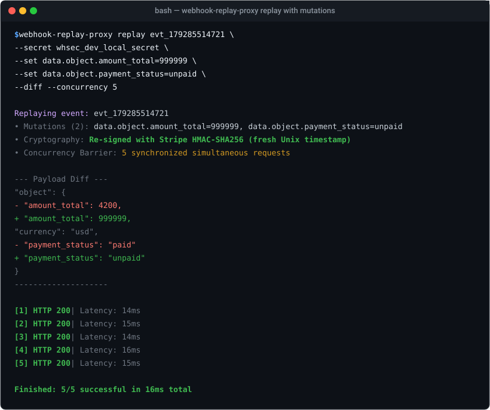

# Worked Examples

Explore real-world scenarios demonstrating how `webhook-replay-proxy` solves webhook testing challenges.

---

## Example 1: Testing Stripe Payment Failure Scenarios

### The Scenario
You captured a successful `checkout.session.completed` event from Stripe in production, but you need to test what happens when the checkout status is `unpaid` and the amount exceeds credit limits.

### Step-by-Step

1. **Find the captured event ID** via `list`:
   ```bash
   webhook-replay-proxy list
   ```

2. **Inspect the original payload**:
   ```bash
   webhook-replay-proxy inspect evt_179285514721
   ```
   

3. **Replay with field mutations & HMAC re-signing**:
   ```bash
   webhook-replay-proxy replay evt_179285514721 \
     --secret whsec_dev_local_secret \
     --set data.object.amount_total=999999 \
     --set data.object.payment_status=unpaid \
     --diff
   ```

   

4. **Result**:
   Your backend's Stripe webhook handler receives the modified event with a **valid timestamp** and **valid HMAC signature**. Your failure handling code executes immediately without rejecting the signature!

---

## Example 2: Testing Idempotency Locks Under Concurrent Storms

### The Scenario
When third-party providers experience network timeouts, their servers automatically retry sending webhooks. If two or more identical webhooks arrive at the exact same millisecond, does your application process the order twice or correctly acquire an idempotency lock?

### Step-by-Step

Run the replay with `--concurrency <N>`:

```bash
webhook-replay-proxy replay evt_179285514721 \
  --secret whsec_dev_local_secret \
  --concurrency 10
```

### How the Synchronization Barrier Works
Rather than looping over requests, `webhook-replay-proxy` initializes 10 goroutines and holds them at a `sync.WaitGroup` start barrier. When all 10 are connected and ready, the gate closes and all 10 HTTP requests hit your server at the exact same instant:

```text
Replaying event: evt_179285514721
• Concurrency: 10 request(s)

[1] HTTP 200 | Latency: 12ms   <- First request processed successfully
[2] HTTP 409 | Latency: 13ms   <- Idempotency conflict detected!
[3] HTTP 409 | Latency: 13ms   <- Duplicate ignored
[4] HTTP 409 | Latency: 14ms
[5] HTTP 409 | Latency: 14ms
[6] HTTP 409 | Latency: 14ms
[7] HTTP 409 | Latency: 15ms
[8] HTTP 409 | Latency: 15ms
[9] HTTP 409 | Latency: 16ms
[10] HTTP 409 | Latency: 16ms

Finished: 1/10 (9 conflicts safely handled) in 17ms total
```

---

## Example 3: GitHub Webhook Replay with Custom Payloads

### The Scenario
You are developing a GitHub App or CI automation bot that reacts to `pull_request` events. You want to test how your system reacts when a PR is merged into a different base branch without creating real GitHub PRs.

```bash
webhook-replay-proxy replay evt_179285519842 \
  --provider github \
  --secret github_webhook_dev_secret \
  --set pull_request.merged=true \
  --set pull_request.base.ref=production \
  --diff
```

`webhook-replay-proxy` recomputes the `X-Hub-Signature-256: sha256=<hex_hmac>` header and delivers it to your target application.

---

## Example 4: Exporting Ready-to-Run `curl` Commands

### The Scenario
You want to share an exact webhook test command with a teammate or save it in an automated Bash script:

```bash
webhook-replay-proxy curl evt_179285514721 \
  --secret whsec_dev_local_secret \
  --set data.object.amount=5000
```

Output:
```bash
curl -X POST "http://localhost:3000/webhooks" \
  -H "Content-Type: application/json" \
  -H "Stripe-Signature: t=1792855900,v1=4a5b6c7d8e9f..." \
  --data '{"data":{"object":{"amount":5000}},"type":"payment_intent.succeeded"}'
```

You can pipe this command or paste it straight into Postman, Insomnia, or CI runners.
